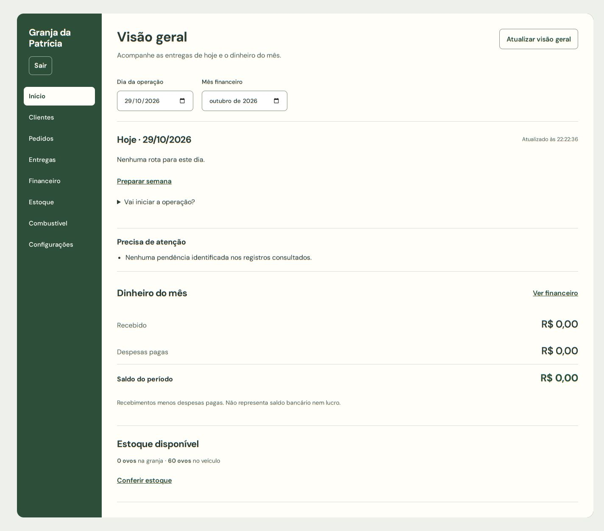

# Granja da Patrícia — Gestão de Entregas

Sistema web em produção para um pequeno negócio de distribuição de ovos. Ele cobre o ciclo semanal da operação: clientes, pedidos, rotas de entrega, motorista, estoque, pagamentos com comprovante, combustível e o resultado financeiro do mês.

O projeto substituiu uma planilha que controlava mais de mil cadastros. A migração preserva cada registro original e manda os casos ambíguos para conferência manual em vez de unir pessoas por nome ou telefone.

> Projeto freelance desenvolvido para uma cliente real. Este repositório é a versão pública do código: não contém dados de clientes, credenciais nem identificadores da infraestrutura de produção.



---

## Funcionalidades

| Módulo | O que faz |
|---|---|
| **Visão geral** | Entregas do dia, pendências que precisam de atenção e dinheiro do mês. |
| **Clientes** | Cadastro completo com endereço, localidade, observações e status de conferência. Importação por CSV com validação e deduplicação. |
| **Pedidos** | Pedido padrão por cliente e preparação da semana, com **uma entrega por cliente por semana** garantida no banco. |
| **Rotas** | Proposta de roteiro agrupada por bairro e ordem de paradas. Estimativa de distância e duração sob demanda (Geoapify). |
| **Motorista** | Tela mobile com a rota do dia, parada por parada, abertura direta no Google Maps e confirmação de entrega. |
| **Estoque** | Entradas, saídas por entrega, saldo de abertura e correções auditáveis. |
| **Financeiro** | Pagamentos por cliente, **comprovantes em armazenamento privado** e relatório mensal. |
| **Combustível** | Registro de abastecimentos ligado ao custo da operação. |
| **Configurações** | Produtos, parâmetros da operação e importação. |

**Acesso:** não há cadastro público; os usuários entram por convite administrativo. São dois perfis: **dona** (acesso total) e **motorista** (só a própria rota). As permissões são aplicadas no banco por Row Level Security, não apenas na interface.

---

## Arquitetura

```
Navegador (React SPA)
   │  supabase-js (chave pública + sessão do usuário)
   ▼
Supabase ── Postgres (RLS, funções, constraints) · Auth · Storage privado
   ▲
   │  chave de serviço (somente no servidor)
Cloudflare Worker ── serve o SPA e expõe /api para comprovantes e mapas
```

- **Regras de negócio no banco:** constraints, funções SQL e políticas RLS garantem as invariantes, como a entrega única semanal, o estoque que nunca fica negativo e o isolamento por perfil. A interface não é a única barreira.
- **Segredos fora do frontend:** a `service_role` e a chave do Geoapify existem só como segredos do Worker. O navegador recebe apenas a URL e a chave pública do Supabase.
- **Concorrência:** pedidos e baixas de estoque são testados com operações simultâneas reais contra o Postgres.
- **Mapas sem custo fixo:** a navegação abre o Google Maps por link, sem API paga, e a distância e a duração vêm do plano gratuito do Geoapify, calculadas sob demanda.

---

## Stack

| Camada | Tecnologia |
|---|---|
| Frontend | React 19 · TypeScript · Vite 7 |
| Backend | Supabase (PostgreSQL, Auth, Storage, RLS) · Cloudflare Workers (Wrangler) |
| Mapas | Google Maps (deep link) · Geoapify Routing |
| Testes | Vitest · pgTAP (`supabase test db`) · Playwright · testes de concorrência em Node |

---

## Estrutura

```
src/
├── app/                # Shell, sessão, tema
├── features/           # customers, orders, routes, driver, stock, finance, fuel, dashboard, settings
├── lib/                # Cliente Supabase, tipos gerados, datas de negócio
└── server/             # Worker: comprovantes e mapas
supabase/
├── migrations/         # Schema, RLS e funções, por domínio
├── tests/              # Testes pgTAP por domínio
└── seed.sql            # Dados fictícios para desenvolvimento
tests/                  # E2E (Playwright), storage, admin e recuperação de acesso
scripts/                # Dev local, criação de usuários, deploy, smoke tests
docs/                   # Guias de operação e sistema visual
```

---

## Rodando localmente

**Requisitos:** Node 22, npm, [Supabase CLI](https://supabase.com/docs/guides/cli) e Docker (ou Podman com socket compatível).

```bash
npm ci
supabase start          # Postgres, Auth e Storage locais
npm run dev:local       # injeta a configuração local e sobe o Vite
```

Abra `http://127.0.0.1:5173`. Para criar um usuário local, veja [docs/operations/access.md](docs/operations/access.md).

### Variáveis de ambiente

| Variável | Onde | Descrição |
|---|---|---|
| `VITE_SUPABASE_URL` | Frontend | URL do projeto Supabase |
| `VITE_SUPABASE_ANON_KEY` | Frontend | Chave pública do Supabase |
| `SUPABASE_URL`, `SUPABASE_ANON_KEY` | Worker | Acesso ao Supabase pelo servidor |
| `SUPABASE_SERVICE_ROLE_KEY` | Worker (secret) | Usada só no servidor. **Nunca no frontend** |
| `GEOAPIFY_API_KEY` | Worker (secret) | Estimativa de distância e duração |
| `SUPABASE_PROJECT_REF`, `CLOUDFLARE_ACCOUNT_ID`, `GRANJA_SITE_URL` | Scripts | Destino de deploy e smoke tests |

Veja [`.env.example`](.env.example).

---

## Testes

```bash
npm run check   # TypeScript + build
npm test        # unitários, banco (pgTAP + concorrência), admin, storage e E2E
```

A suíte usa Postgres, Auth e Storage reais da stack local, sempre com **dados fictícios**. Os testes de operação exigem estoque local vazio e restauram apenas as próprias fixtures.

---

## Deploy

O frontend e a API são publicados juntos como um Cloudflare Worker com assets estáticos. As migrações vão para o projeto Supabase de produção. Os detalhes estão em [docs/operations/deploy.md](docs/operations/deploy.md) e o backup e a restauração em [docs/operations/backup-restore.md](docs/operations/backup-restore.md).

---

## Documentação

- [Acesso e recuperação](docs/operations/access.md)
- [Primeira rota e saldos de abertura](docs/operations/first-route.md)
- [Roteiros por bairro](docs/operations/routes-by-locality.md)
- [Importação CSV](docs/operations/import.md) · [Migração de planilha](docs/operations/data-migration.md)
- [Comprovantes privados](docs/operations/receipts.md)
- [Mapas e limites](docs/operations/maps.md)
- [Sistema visual](DESIGN.md)

---

## Autor

**Emmanuel Noronha**, desenvolvedor Full-Stack.
